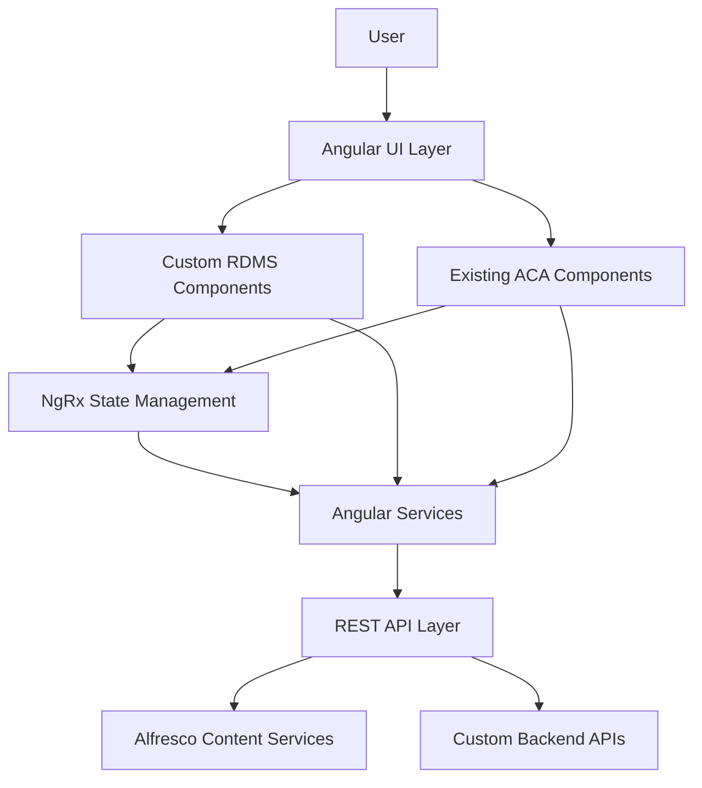
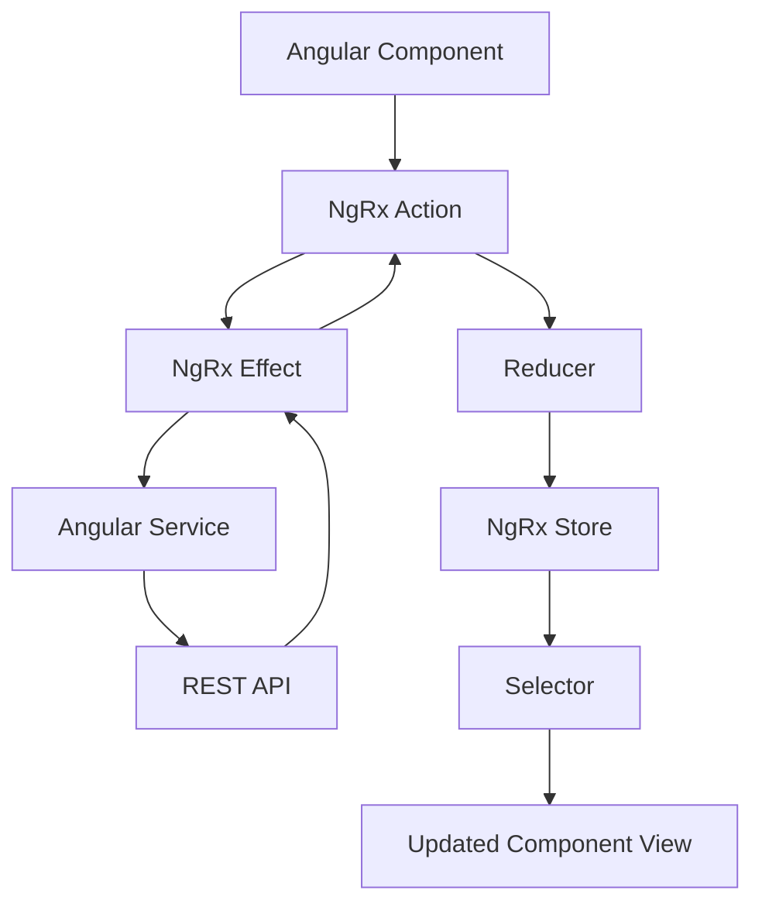

# RDMS Frontend Architecture

## 1. Purpose

This document describes the frontend architecture of RDMS and explains how the application extends the Alfresco Content Application (ACA).

The focus is on the Angular frontend, its custom components, state management, configuration, and integration with external services.

This document does not describe the internal implementation of backend services or infrastructure managed by other teams.

## 2. Application Foundation

RDMS frontend is built by customizing the open-source Alfresco Content Application (ACA).

The application uses the existing ACA foundation and extends it with RDMS-specific functionality.

The main architectural elements are:

- **Alfresco Content Application (ACA):** Provides the application foundation and reusable document-management functionality.
- **Angular 17:** Provides the frontend application framework.
- **Custom Angular components:** Implement RDMS-specific screens, dialogs, and interactions.
- **NgRx:** Manages application state using actions, reducers, effects, selectors, and the store.
- **RxJS:** Supports reactive data handling and asynchronous operations.
- **Angular services:** Handle application logic and communication with APIs.
- **ACA extensions and JSON configuration:** Support configuration and integration of application actions and other extension points.

## 3. High-Level Frontend Architecture

The frontend can be understood through the following layers:

This diagram represents the frontend's logical structure and its integration boundaries. It does not describe the internal implementation of the backend.

## 4. ACA Customization and Extension

RDMS extends the existing ACA application rather than replacing its underlying document-management foundation.

The frontend customization includes:

- Creating RDMS-specific Angular components and dialogs.
- Modifying existing ACA components where additional functionality was required.
- Reusing existing Alfresco components and services.
- Extending document actions through ACA's extension and configuration mechanisms.
- Configuring application menus, navigation, forms, and fields.

### 4.1 Document Actions Extension

The existing ACA Document Actions Panel was customized to support RDMS-specific actions.

The action configuration uses:

- `app.extensions.json`
- `AppExtensionService`
- Existing ACA action and service functionality
- Custom action implementations where required

This approach allows RDMS functionality to integrate with the existing ACA application structure.

## 5. Component Architecture

The frontend contains both reusable ACA components and custom RDMS components.

### 5.1 Existing ACA Components

Existing ACA functionality is reused where appropriate, including:

- Document viewing.
- Document-management actions.
- Existing services.
- Application extension mechanisms.
- Existing document-management functionality.

Some existing components were also customized to meet RDMS requirements.

### 5.2 Custom RDMS Components

Custom frontend components implement functionality that was not available in the required form in the original ACA application.

Examples include:

- Document Detail Page.
- Properties V2 dialog and supporting components.
- Document comments interface.
- Workflow status interface.
- My Tasks interface.
- Workflow and task-completion dialogs.

The Document Detail Page brings together document viewing and related document functionality.

## 6. State Management and Data Flow

NgRx is used for frontend state management.

The application uses the main NgRx building blocks:

- **Actions:** Represent events and requests in the application.
- **Reducers:** Define how state changes in response to actions.
- **Effects:** Handle side effects and asynchronous operations.
- **Selectors:** Retrieve and derive data from application state.
- **Store:** Holds the application state.

RxJS is used to handle asynchronous data streams and coordinate operations.

A simplified representation of the frontend data flow is:

This is a simplified representation of a common NgRx request-and-response flow. Not every frontend operation necessarily follows this exact sequence.

## 7. External Integrations

The frontend communicates with existing platform services and custom backend APIs.

### 7.1 Alfresco Content Services

Alfresco Content Services provides the document repository capabilities used by the application.

The frontend integrates with Alfresco functionality through existing ACA/ADF components, services, and REST APIs.

### 7.2 Authentication Integration

The frontend contains Basic and Keycloak login interfaces.

The frontend authentication approach was adapted from Basic authentication to OAuth-based authentication for Keycloak integration.

Keycloak server configuration and infrastructure are managed outside the frontend contribution.

### 7.3 Workflow Integration

The frontend provides interfaces to initiate document review and approval workflows, assign users, and complete assigned tasks.

Workflow execution and backend implementation are handled by the backend team. The workflow engine used by the project is Camunda.

## 8. Responsibility Boundaries

The following distinction describes the scope of the frontend contribution.

| Area | Responsibility |
|---|---|
| Angular application and custom components | Frontend |
| ACA component customization | Frontend |
| NgRx state management | Frontend |
| JSON-based ACA configuration | Frontend |
| Frontend API integration | Frontend |
| Backend services and business logic | Backend team |
| Camunda workflow implementation | Backend team |
| Keycloak server and infrastructure | Backend team |

## 9. Scope of This Document

This document describes the known frontend architecture and integration boundaries of RDMS.

It is not a complete system architecture specification. Backend internals, database architecture, deployment infrastructure, and server-side implementation details are outside its scope.
